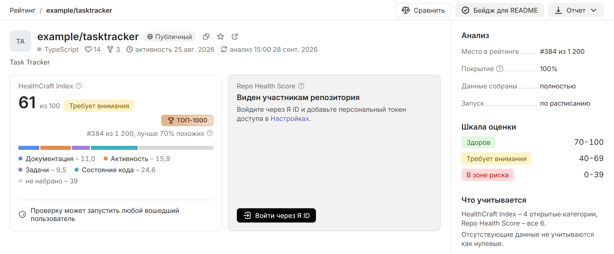
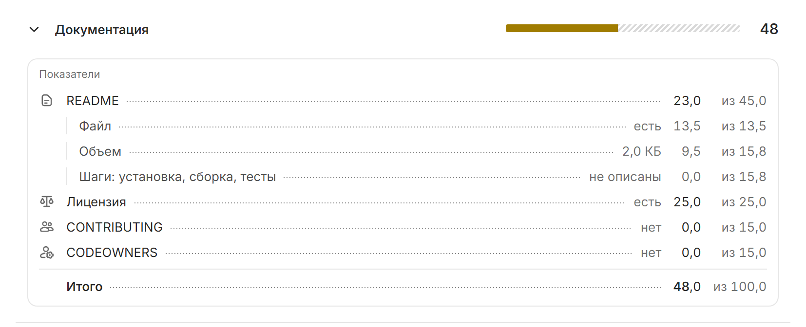

# Карточка репозитория и отчеты

Карточка показывает оценку репозитория и то, из чего она сложилась. Ее адрес – `https://health-craft.ru/repo/<org>/<repo>`. Карточку открытого репозитория видно без входа, а закрытого – только участникам с персональным токеном SourceCraft; как его сохранить, описано в разделе [Вход и персональный токен](../quickstart.md#login).

В примерах – выдуманный `example/tasktracker` с HealthCraft Index 61.

## Шапка и действия

В шапке – имя репозитория, плашка [[pill+public:Публичный]], [[pill+internal:Внутренний]] или [[pill+private:Приватный]], звезда избранного, ссылка [[external:Открыть на sourcecraft.dev]], язык, реакции, ответвления, даты активности и анализа.

Кнопки действий:

- [[compare:Сравнить]] добавляет репозиторий в [сравнение](rating.md#sravnenie);
- [[badge:Бейдж]] выдает код бейджа, подробнее – на странице [Бейдж и публичный API](badge-api.md);
- [[download:Отчет]] выгружает [отчет в Markdown или PDF](#otchety);
- [[Обновить анализ]] запускает новый анализ и есть у своего репозитория и у репозиториев ваших организаций, как описано в разделе [Повторный анализ](../quickstart.md#rescan).

[[compare:Сравнить]] есть только у репозитория с оценкой, [[badge:Бейдж]] – только у своего репозитория с оценкой, то есть из раздела [[Мои репозитории]]. Кнопки действий стоят в верхней строке страницы справа. Когда им не хватает места, остается главная кнопка – [[Обновить анализ]], если анализ можно запустить, или [[compare:Сравнить]], – а [[badge:Бейдж]] и [[download:Отчет]] уходят в меню [[more:Еще действия]]. На мобильных устройствах в меню уходит и [[compare:Сравнить]].



## Оценка, место и лига

Плашка HealthCraft Index показывает оценку и зону, например 61 из 100 и [[label-warning:Требует внимания]]. Справа – лига, например [[league-bronze:TOP-1000]], и строка места, например «#152 из 28 500, лучше 94% похожих». Как считаются место и лига, описано в разделе [Место и лига](rating.md#mesto-liga).

Под оценкой идет полоса вклада категорий. Она показывает, сколько баллов итога дала каждая категория, и в сумме равна показанной оценке. Остаток со штриховкой [[не набрано]] – баллы, которых не хватило до 100. Наведите указатель на часть полосы или пункт под ней – часть подсветится, а подсказка покажет: у категории – ее вклад из наибольшего возможного и долю оценки, например «Документация», ниже «12,5 из 23,0» и тише – «15% оценки»; у остатка – в какой категории недобрано больше всего, например «Не набрано 16», ниже «больше всего – Документация» и тише – «10,5».

Если в репозитории нет кода, оценка 0 стоит серым с отметкой [[label-unknown:нет кода]], а не в зоне риска: оценивать нечего. Проверки активности и AI-обзора у такого репозитория нет.

Вторая плашка – Repo Health Score. Если вам закрыта CI/CD или Безопасность, вместо числа стоит заголовок [[Виден участникам репозитория]] и путь к полной оценке. Если вы не вошли, под ним есть кнопка [[login:Войти]].

Состояние проверки активности показывает отдельная плашка, например [[shield-check:Признаков искусственной активности нет]]. Если Repo Health Score вам закрыт, она стоит на месте его плашки, рядом с HealthCraft Index, а если виден – на всю ширину под плашками оценок. Проверку и AI-обзор описывает страница [Внешние сервисы и AI](../data/ai.md).

## Место среди похожих {#pohozhie}

Похожие – открытые репозитории с местом в рейтинге, у которых тот же язык и та же группа размера, как в фильтре [[Размер:]] рейтинга. Процент показывает долю похожих, у которых округленный индекс строго ниже, например «лучше 94% похожих». Если похожих меньше 30, карточка пишет «похожих мало для сравнения».

## Категории

Раздел [[Категории]] начинается итогом, например «Сильнее всего – состояние кода и задачи. Слабее всего – документация: нет правил для участников и не назначены ответственные за код». Баллы категорий – на полосах под итогом. В итоге – до 2 категорий с баллом от 70 и категория с наименьшим баллом ниже 70; после двоеточия сказано, каких ее показателей не хватает больше всего. Если все категории ниже 70, итог начинается с лучшей из них: «Лучше всего – …». В отчете Markdown и PDF вместо итога – строка «Сильные стороны: … Слабые стороны: …».

В строке категории – название, полоса и балл. Заливка полосы – балл категории, ненабранное – штриховкой. Цвет полосы – зона балла: зеленый – «Здоров», желтый – «Требует внимания», красный – «В зоне риска».

Над разделом стоит AI-обзор репозитория, если он есть. Значок искр у заголовка [[Категории]] означает, что у каждой категории есть AI-разбор: он открывается вместе с категорией.

Нажмите строку, чтобы раскрыть категорию. В раскрытии – блоки:

- [[Показатели]] – подметрики, из которых складывается балл категории; блок обведен рамкой;
- [[Справочные показатели]] – подметрики, которые в балл не входят; стоят справа от показателей, на узком экране – под ними;
- [[Находки AppSec]] в [[Безопасность]] – открытые находки по видам проверок;
- [[Карта владельцев]] в [[Состояние кода]] – владельцы файлов по каталогам.

Блоки, которые в балл не входят, стоят на серой подложке, а в их правом углу написано «в балл не входит». Под блоками – AI-разбор категории, если он есть.

В блоке [[Показатели]] у каждой подметрики – иконка, название и значение, а справа – сколько баллов категории она набрала из своего веса, например «29,3 из 45,0». Пунктир ведет от названия к значению, баллы стоят разряд под разрядом. README разложен на 3 части: файл, объем и описанные шаги установки, сборки и тестов. Наведите указатель на строку, чтобы увидеть расчет, например «Набрано 43,9% от 45,0 = 19,8». Подметрики без балла – данных нет или доля тестов не учтена – отмечены прочерком. Если задач или кода мало для надежной оценки, балл поправлен после суммы – отдельной строкой, например «Поправка: мало кода». Последняя строка, «Итого», – балл категории, например «85,0 из 100,0».

[[Карта владельцев]] показывает дерево каталогов. У каталога – полоса долей изменений его главных авторов, подсказка у полосы называет главных авторов с их долями и долю остальных, а роботы отмечены значком робота. Каталог верхнего уровня раскрывается до 5 подкаталогов. Под деревом – правило: «Единственный владелец – от 80% изменений». Что показывают справочные данные, описано на странице [Категории и метрики](../method/metrics.md).

Если данных нет, вместо балла стоит прочерк и плашка [[label-unknown:Нет данных]] с причиной. Метка [[label-warning:Данные из прошлого анализа]] означает, что часть фактов взята из прошлого анализа; оба случая разобраны на странице [Обработка отсутствующих данных](../method/no-data.md). Раздел [[Ограничения данных]] появляется, если данные неполные, например история коммитов загружена частично.



## Рекомендации и история оценки

В разделе [[Рекомендации]] перечислены действия с ожидаемым эффектом и заготовки файлов. Если все категории в зоне «Здоров», раздел пишет: «Рекомендаций нет: все категории в зоне „Здоров“. Оставшиеся баллы не добрать разовым действием – они растут вместе с активностью проекта.» Как рекомендации составляются, описано на странице [Формирование рекомендаций](../method/recommendations.md).

Раздел [[История оценки]] показывает график HealthCraft Index по датам анализов. Шкала графика подстраивается под оценки, а линии порогов 40 и 70 видны, если попадают в ее пределы. Точка окрашена в цвет своей зоны, отрезок до следующей точки – в цвет зоны левой точки, поэтому переход между зонами виден на самой линии. Если вам виден Repo Health Score, он идет серой линией с полыми точками. Легенды нет: у конца каждой линии написаны текущая оценка и название линии, а над прошлыми точками – их оценки. Если числа соседних точек наложились бы друг на друга, лишнее не показывается – значение видно в подсказке при наведении на точку. График строится по оценкам текущей версии методики и появляется, когда оценка есть хотя бы у 2 анализов. Он начинается с первой оценки с числом и заканчивается последней, а где данных для оценки не было, линия прерывается. При 1 оценке вместо графика – текст «Пока есть одна оценка по текущей версии методики – график появится со вторым анализом. Новая оценка появляется после каждого анализа.» Список [[Все анализы]] показывает каждый анализ с оценкой: время, под ним короткий хеш коммита, справа – оценки; у анализа репозитория без кода – метка [[label-normal:нет кода]]. Анализы, которые завершились сбоем, в историю не входят: оценки они не дают.

Под графиком, отделенный линией, идет блок [[Что изменилось]]: он объясняет, почему оценка стала такой. По умолчанию он сравнивает конец дня перед последним изменением оценки с последним анализом; другие дни можно выбрать в двух полях с датами – в каждом дне берется его последний анализ. Если вам виден Repo Health Score, переключатель [[HealthCraft Index]] / [[Repo Health Score]] показывает разбивку полного показателя – с CI/CD и Безопасностью. Сверху крупно – оценки выбранных дней и разница между ними. Ниже – категории, которые сдвинули оценку: длина полосы показывает вклад категории относительно самого большого, зеленая полоса – категория прибавила, красная – убавила. Вклады целые и в сумме дают разницу оценок. Под категорией одной фразой сказано, что изменилось, например «появились лицензия и CONTRIBUTING, README подробнее»; точные значения «было → стало» – в подсказке при наведении на фразу. Если у категории появились данные, она входит в оценку со своим баллом и может снизить ее, хотя проект не ухудшился. Если оценка не менялась, раздела нет. В списке [[Все анализы]] у оценки, которая изменилась, стоит разница с прошлым анализом, а под строкой – за счет каких категорий, теми же фразами.

Раздел [[Анализ]] правой панели показывает место в рейтинге, [[Полнота данных]], строку [[Данные собраны]] со значением «полностью» или «частично» и способ запуска анализа: в строке [[Запуск]] указано «по расписанию» или «вручную». Если вам виден Repo Health Score, вместо одной строки полноты стоят 2: [[Полнота: HealthCraft Index]] и [[Полнота: Repo Health Score]]. Если после показанной оценки запущен новый анализ, строка [[Новый анализ]] говорит, что с ним: «идет – оценка обновится по итогу» или, если он не удался, «не удался 20 окт. 2026, 00:37 – показан прошлый». Ниже идут шкала зон, состав показателей и раздел [[Сведения]] со строками [[Номер анализа]] и [[Версия методики]]: это номер того анализа, по которому посчитана показанная оценка. Время анализа указано в шапке карточки.

Если оценки нет, карточка называет причину: анализа еще не было, он запланирован или идет, завершился сбоем, данных не хватило или репозитория нет в открытом каталоге. Надпись [[Оценки пока нет]] не означает плохую оценку.

## Отчеты Markdown и PDF {#otchety}

Отчет – документ с оценкой, фактами и рекомендациями, который читается без HealthCraft. Числа в нем те же, что на карточке в момент выгрузки, а рекомендации идут под теми же номерами. В приложении «Расчет оценки и исходные данные» собраны баллы, веса и факты, по которым расчет оценки можно повторить вручную. В таблице расчета у каждой категории – балл, вес и баллов в итог, а под таблицей – пояснение «Баллов в итог = балл × вес, до десятых – так, чтобы строки сложились в итог». Даты в отчете указаны по Москве, у времени – пометка «МСК». Отчет есть только у репозитория с оценкой.

Чтобы скачать отчет:

1. На карточке нажмите [[download:Отчет]].
2. Выберите [[markdown:Markdown (.md)]] или [[pdf:PDF (.pdf)]].

В отчет входят показатели и вклад категорий, сильные и слабые стороны, рекомендации, разбор подметрик и приложение с расчетом.

Отчет собирается по правам того, кто его скачивает. Участник с доступом к CI/CD и Безопасности получает «Полную оценку» с Repo Health Score и этими категориями. Остальные получают «Публичную оценку»: закрытая зрителю категория отмечена в ней «Недоступно», без чисел и фактов. Если из CI/CD и Безопасности доступна только одна категория, отчет остается публичным, но доступная категория идет в нем с баллом и фактами. Отчет закрытого репозитория может скачать только тот, кому видна его карточка; подробнее – на странице [Источники данных и приватность](../data/sources.md).

Отчет открытого репозитория можно скачать и без браузера, с публичной оценкой. Для PDF замените `report.md` на `report.pdf`:

```bash
curl -OJ https://health-craft.ru/api/repos/<org>/<repo>/report.md
```

## Полезные ссылки

- [Рейтинг и сравнение репозиториев](rating.md)
- [Показатели и формула расчета](../method/scores.md)
- [Формирование рекомендаций](../method/recommendations.md)
- [Бейдж и публичный API](badge-api.md)
