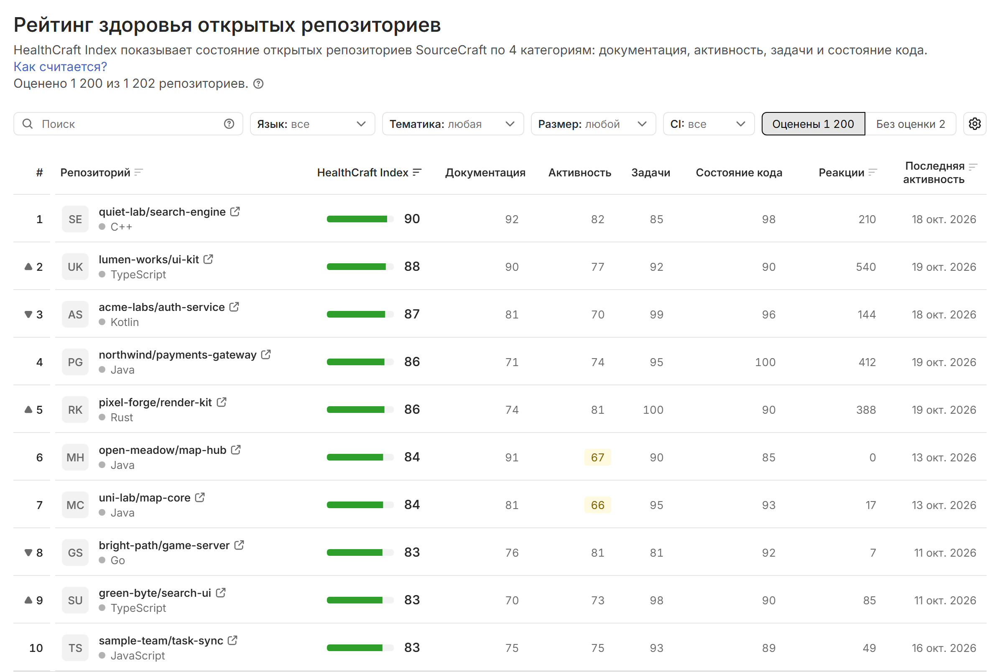
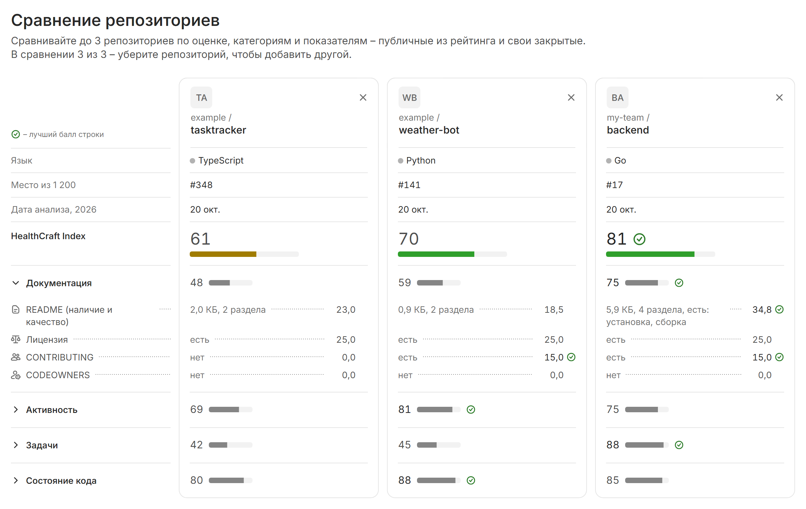

# Рейтинг и сравнение репозиториев

Рейтинг – список открытых репозиториев SourceCraft, упорядоченный по HealthCraft Index от большего к меньшему. Раздел [[rating:Рейтинг]] открывается на главной странице [health-craft.ru](https://health-craft.ru) и работает без входа. Почему репозитории упорядочены по HealthCraft Index, а не по Repo Health Score, объясняет раздел [Почему рейтинг по HealthCraft Index](../method/scores.md#pochemu-index).

## Колонки

| Колонка | Что показывает |
|---|---|
| [[#]] | место в рейтинге и стрелка изменения за сутки |
| [[Репозиторий]] | имя, язык и значки строки |
| [[HealthCraft Index]] | оценка 0-100 с полосой, цвет – по зоне |
| [[Документация]], [[Активность]], [[Задачи]], [[Состояние кода]] | баллы 4 категорий индекса |
| [[Реакции]] | оценка реакций из каталога SourceCraft |
| [[Последняя активность]] | дата последней активности в репозитории по каталогу SourceCraft |

На вкладке [[Оценены]] кнопка с шестеренкой над таблицей открывает список колонок. Ее подсказка показывает, сколько колонок видно, например «Колонки: 9 из 12». В списке есть скрытые по умолчанию колонки [[Ответвления]], [[Полнота данных]] и [[Анализ]] – дата и статус последнего анализа. В заголовке таблицы полнота данных подписана коротко – [[Полнота]]. На телефоне кнопки нет.

Балл категории ниже 70 выделен плашкой: желтой для 40-69, красной для 0-39. Плашка [[label-unknown:н/д]] означает, что данных нет: такая категория в оценке не участвует и не снижает ее.

Значки и метки в строке:

- [[external:Открыть на sourcecraft.dev]] – ссылка на репозиторий в SourceCraft;
- [[ai:Есть AI-обзор]] – у репозитория есть AI-обзор, о нем рассказывает страница [Внешние сервисы и AI](../data/ai.md);
- [[flag:Признаки искусственной активности]] – проверка активности нашла такие признаки, подробнее – в разделе [Отметка проверки активности](#nakrutka);
- [[label-unknown:нет кода]] – оценка 0 стоит серым: оценивать нечего, и к зоне риска такой репозиторий не относится;
- [[label-warning:Из истории]] – часть данных взята из прошлого анализа.

По умолчанию сверху – репозитории с самой высокой оценкой. Чтобы отсортировать по другой колонке, нажмите ее заголовок. Нажмите строку, чтобы открыть [карточку репозитория](card.md).



## Поиск и фильтры {#filtry}

- [[search:Поиск]] ищет по организации и названию репозитория без учета регистра: подходит часть адреса вида `организация/репозиторий` или заголовка репозитория. В поле можно вставить и ссылку на репозиторий в sourcecraft.dev – поиск возьмет из нее адрес.
- [[Язык:]] отбирает один или несколько языков, а пункт [[не определен]] – репозитории без языка.
- [[Тематика:]] отбирает одну или несколько тем: [[Боты]], [[Веб]], [[ML и данные]], [[Игры]], [[Учебные]], [[Мобильные]], [[DevOps]], [[Инструменты]]; число у темы – сколько репозиториев в ней. При нескольких темах показываются репозитории с любой из них. В SourceCraft у репозитория тем нет, поэтому тема определяется правилами: по словам в адресе, заголовке и описании, по основному языку и по зависимостям из манифестов (например, `package.json`, `requirements.txt`, `go.mod`). У репозитория может быть несколько тем или ни одной; на оценку и место тема не влияет.
- [[Размер:]] делит репозитории по числу строк кода: [[без кода]], [[до 1 тыс. строк]], [[1-10 тыс. строк]], [[10-100 тыс. строк]], [[больше 100 тыс. строк]].
- [[CI:]] разделяет репозитории на [[есть CI]] и [[нет CI]] по наличию файла `.sourcecraft/ci.yaml`.
- [[ai:С AI-обзором]] оставляет только репозитории с AI-обзором.

На телефоне язык, тематика, размер, CI и [[ai:С AI-обзором]] собраны в панели, которую открывает кнопка [[Фильтры]]; число на кнопке – сколько фильтров включено. Строка рейтинга на телефоне – в два яруса: имя репозитория целиком, под ним язык и HealthCraft Index.

Поиск, фильтры, сортировка и номер страницы сохраняются в адресе, поэтому выборкой можно поделиться, просто скопировав ссылку. Если ничего не подошло, нажмите [[Сбросить фильтры]]: поиск и фильтры очистятся, а вкладка и сортировка останутся. Если в поиске точный адрес или ссылка, рядом стоит кнопка вида [[Открыть example/tasktracker]]: она открывает карточку и того репозитория, которого еще нет в рейтинге.

## Место и лига {#mesto-liga}

Место – позиция по округленному HealthCraft Index среди всех оцененных открытых репозиториев. При равных индексах выше стоит репозиторий, чей адрес (организация/репозиторий) раньше по алфавиту. Поиск, фильтры и сортировка место не меняют.

Стрелка рядом с местом сравнивает его с последним ежесуточным снимком рейтинга. Подсказка покажет сдвиг, например «Поднялся на 12 за сутки: вчера – 164 место». Если место не изменилось или вчерашнего снимка нет, стрелки нет.

Лига – отметка [[league-gold:TOP-10]], [[league-silver:TOP-100]] или [[league-bronze:TOP-1000]]. Репозиторий получает лигу, если репозиториев с индексом не ниже его собственного, включая его самого, не больше 10, 100 или 1000. Лига TOP-N выдается, только когда в рейтинге больше N репозиториев.

У равных индексов лига одна. Например, 12 репозиториев с одинаковым индексом занимают места с 5 по 16. Ни один из них не получает TOP-10, и все получают TOP-100.

Лигу показывают карточка репозитория и бейдж с чипом [[Лига]], в таблице рейтинга ее нет. Место и лига на оценку не влияют. Как считается место среди похожих репозиториев, описано в разделе [Место среди похожих](card.md#pohozhie).

## Отметка проверки активности {#nakrutka}

Значок [[flag:Признаки искусственной активности]] стоит у репозитория, если последняя проверка активности нашла такие признаки. Отметка – только повод посмотреть на репозиторий внимательнее: оценку и место она не меняет. Как работает проверка – на странице [Устойчивость оценки и защита от накрутки](../method/robustness.md).

## Без оценки и полнота данных

Вкладка [[Оценены]] показывает репозитории с HealthCraft Index, а [[Без оценки]] – проанализированные репозитории, у которых полнота данных ниже 40%. Почему оценки нет, объясняют колонки [[Полнота данных]] и [[Не хватило данных]]. Вкладка показывает первые 5 репозиториев по алфавиту и строку «…и еще N»: чтобы найти нужный, уточните поиск или фильтры. Полнота данных показывает, какая доля веса категорий получила данные; подробнее – в разделе [Порог данных](../method/scores.md#porog-dannyh).

Ссылка [[Как считается?]] под заголовком открывает панель со шкалой зон, вкладом категорий в индекс, порогом оценки, версией методики и частотой обхода. Как часто обновляется рейтинг – на странице [Периодический анализ и масштабирование](../ops/scaling.md).

## Сравнение репозиториев {#sravnenie}

Раздел [[compare:Сравнение]] ставит рядом оценки 2-3 репозиториев: индекс, категории и подметрики. Сравнить можно открытые репозитории из рейтинга и свои закрытые, если их карточка вам видна. Раздел работает без входа.

Чтобы сравнить репозитории:

1. В левой панели откройте [[compare:Сравнение]] и нажмите [[Добавить репозиторий]].
2. Введите название, адрес вида `организация/репозиторий` или ссылку и добавьте репозиторий кнопкой с плюсом или клавишей Enter. Так же добавьте остальные.
3. Нажмите [[Готово]].

С карточки репозиторий добавляет кнопка [[compare:Сравнить]]: карточка остается открытой, а в уведомлении есть кнопка [[Открыть]] для перехода к сравнению. Пустое сравнение предлагает готовые наборы: топ-3 рейтинга и, после входа, первые репозитории из избранного. В сравнении не больше 3 репозиториев. Чтобы убрать репозиторий, нажмите крестик [[Убрать из сравнения]] в шапке его столбца.



В столбцах таблицы стоят репозитории. Первые строки – язык, место в рейтинге и дата анализа, затем HealthCraft Index с полосой цвета зоны, Repo Health Score, если он виден, и категории с серой полосой. Общий для всех столбцов размер рейтинга и год анализа стоят в подписи строки, например «Место из 29 971». Лучший балл строки отмечен зеленым кругом с галочкой; легенда – в левом верхнем углу таблицы, а на узком экране – над таблицей. Шапка со столбцами остается на месте при прокрутке.

Нажмите название категории, чтобы увидеть ее подметрики – только те, что входят в балл; справочные подметрики остаются на карточке. В ячейке слева – значение подметрики, справа – сколько баллов категории она набрала, а между ними пунктир. Пояснения к подметрике, например за какой период она считается, собраны в подсказке у знака вопроса рядом с ее названием, а не повторяются в каждом столбце. Если у репозитория нет данных по категории, в первой строке ее подметрик стоит «Нет данных», а причина – в подсказке.

CI/CD и Безопасность идут сразу за категориями индекса и вместе с Repo Health Score появляются, только если эти данные видны вам у всех выбранных репозиториев. AI-обзоры, рекомендации, факты и история оценки остаются на карточке.

На узком экране, например на телефоне, каждая строка таблицы – подпись во всю ширину и под ней значения репозиториев. При 3 репозиториях таблица переходит в такой вид раньше, чем при 2: так значения остаются читаемыми.

Плашка под таблицей предупреждает, если числа сравнимы с оговорками: индексы посчитаны по разному числу категорий, анализы разнесены на 30 дней и больше или в репозитории нет кода.

Набор репозиториев хранится в адресе – скопируйте его, чтобы поделиться сравнением:

```text
https://health-craft.ru/compare?r=<org>/<repo>&r=<org>/<repo>
```

Получатель увидит только то, что доступно ему самому. Если вы вошли, каждый репозиторий в сравнении расходует лимит открытий карточки – он указан на странице [Ограничения](../limits.md).

## Полезные ссылки

- [Карточка репозитория и отчеты](card.md)
- [Показатели и формула расчета](../method/scores.md)
- [Категории и метрики](../method/metrics.md)
- [Бейдж и публичный API](badge-api.md)
