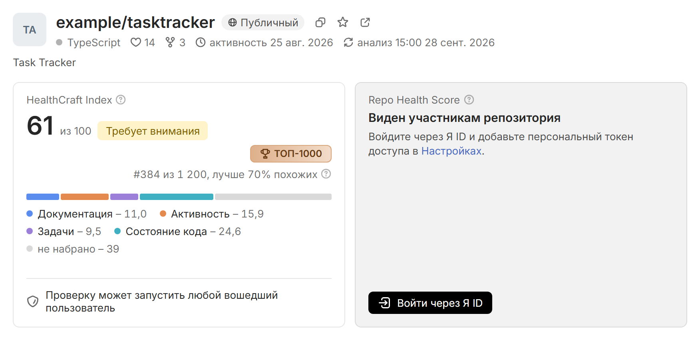

# Обзор HealthCraft

HealthCraft оценивает здоровье открытых репозиториев SourceCraft по шкале 0-100 и объясняет каждую оценку фактами. В рейтинге – весь каталог, около 28 500 открытых репозиториев, и все они оцениваются по одной формуле. Для каждого HealthCraft называет сильные и слабые стороны и составляет рекомендации с посчитанным приростом оценки. Сервис работает на [health-craft.ru](https://health-craft.ru).

## Чем HealthCraft отличается

- Каждый балл выводится из фактов git, REST API и AppSec SourceCraft. Значения подметрик видны в раскрытии категории, а от рекомендации до исходного значения факта – 2 нажатия, как показано в разделе [Переход к фактам](quickstart.md#facts).
- Если по категории нет данных, она выпадает из формулы и не снижает оценку: «нет данных» здесь не значит «плохо». Подтвержденное отсутствие проблем HealthCraft отличает от незнания: проверка AppSec без находок дает Безопасности 100.
- Эффект рекомендации посчитан: HealthCraft пересчитывает оценку так, будто исправление уже сделано. Для 5 рекомендаций по документации есть готовые заготовки файлов.
- Оценку считает код, а не языковая модель, и случайности в расчете нет: одинаковые факты на одну дату анализа всегда дают одинаковую оценку. У каждой оценки записана версия модели, и при смене модели вся история пересчитывается по сохраненным фактам.
- HealthCraft оценивает репозитории на любом языке программирования. Строки кода, файлы тестов и пометки TODO он находит по файлам и комментариям, не разбирая синтаксис конкретного языка, поэтому правила для всех репозиториев одни.
- Реакции и ответвления в формулу не входят, а коммиты роботов и сгенерированные пачки коммитов не учитываются, так что популярностью и накруткой оценку не поднять.
- Закрытые данные остаются закрытыми. CI/CD и Безопасность видят только участники репозитория: HealthCraft проверяет права зрителя по его персональному токену, а публичный рейтинг строится без этих категорий. Репозиторий, который стал закрытым или удален, уходит из рейтинга при ближайшей сверке каталога.
- Безопасность оценивается по тем же находкам AppSec SourceCraft, которые видит команда, без собственных правил сервиса.
- HealthCraft бережет SourceCraft: запросы к API идут с паузами и в пределах бюджета на каждый анализ, а повторно анализируются только изменившиеся репозитории.
- AI-обзор опирается на факты: текст без ссылок на факты анализа не показывается.
- HealthCraft можно развернуть в своей инфраструктуре почти как есть. Все процессы работают из 1 образа, роль процесса и остальные настройки задаются переменными окружения, а для данных достаточно базы SQLite на диске. Как это устроено, описано на странице [Архитектура](ops/architecture.md#roli).

Сколько репозиториев оценено сейчас, можно узнать запросом `GET https://health-craft.ru/api/meta` в поле `repos.scored`.

## Возможности

| Возможность | Страница |
|---|---|
| Рейтинг открытых репозиториев с поиском и фильтрами по языку, размеру кода и наличию CI | [Рейтинг и сравнение репозиториев](guide/rating.md) |
| Место в рейтинге, его изменение за сутки и лиги [[league-gold:ТОП-10]], [[league-silver:ТОП-100]], [[league-bronze:ТОП-1000]] | [Рейтинг и сравнение репозиториев](guide/rating.md) |
| Сравнение 2-3 репозиториев по индексу, категориям и подметрикам | [Рейтинг и сравнение репозиториев](guide/rating.md) |
| Карточка репозитория: оценка, баллы категорий, факты и их источники | [Карточка репозитория и отчеты](guide/card.md) |
| Место среди похожих репозиториев того же языка и размера | [Карточка репозитория и отчеты](guide/card.md) |
| История оценки: график и список всех анализов | [Карточка репозитория и отчеты](guide/card.md) |
| Отчеты Markdown и PDF с оценкой, фактами и рекомендациями | [Карточка репозитория и отчеты](guide/card.md) |
| Рекомендации с посчитанным приростом оценки, режим [[По шагам]] и заготовки файлов | [Формирование рекомендаций](method/recommendations.md) |
| Анализ своих и закрытых репозиториев: вход через Яндекс ID и персональный токен SourceCraft | [Начало работы](quickstart.md) |
| Углубленная аналитика: bus factor, ревью и узкие места, поток задач, карта владельцев файлов, стабильность CI | [Справочные показатели](method/metrics.md#spravochnye) |
| Бейдж для README и публичный API без ключей | [Бейдж и публичный API](guide/badge-api.md) |
| AI-обзор для руководителя с первым шагом и проверкой ссылок на факты анализа до показа | [Внешние сервисы и AI](data/ai.md) |
| Проверка оценки на накрутку и защита рейтинга от искусственной активности | [Устойчивость оценки и защита от накрутки](method/robustness.md) |
| Периодический пересчет: каталог – раз в час, анализ изменившихся репозиториев – раз в сутки | [Периодический анализ и масштабирование](ops/scaling.md) |
| Документация с поиском и PDF-версией | пункт [[docs:Документация]] в левой панели |

## Кому полезен

Владельцам и мейнтейнерам HealthCraft показывает, что мешает проекту, что исправить первым и на сколько после этого вырастет оценка. Тем, кто выбирает проект для работы или в зависимости, он дает сравнимый рейтинг, где популярность не подменяет здоровье: реакции и ответвления в оценку не входят. Платформе SourceCraft HealthCraft добавляет единый слой аналитики поверх git, CI, задач и AppSec, с бейджем и публичным API.

## Как считается оценка

HealthCraft считает 2 показателя. **HealthCraft Index** складывается из 4 категорий и есть у каждого открытого репозитория. **Repo Health Score** добавляет к ним CI/CD и Безопасность, всего 6 категорий, и виден участникам репозитория.

Оценка равна взвешенному среднему баллов тех категорий, по которым есть данные, и попадает в одну из зон: [[label-success:Здоров]] – 70-100, [[label-warning:Требует внимания]] – 40-69, [[label-danger:В зоне риска]] – 0-39. Категория без данных получает [[label-unknown:Нет данных]] и оценку не снижает.

Формула, категории и правила для недостающих данных описаны на страницах [Показатели и формула расчета](method/scores.md), [Категории и метрики](method/metrics.md) и [Обработка отсутствующих данных](method/no-data.md).

## Установка и запуск

HealthCraft можно запустить у себя из исходников или в Docker Compose. Для запуска из исходников:

1. Склонируйте репозиторий и установите зависимости командой `bun install --frozen-lockfile`.
2. Скопируйте `.env.example` в `.env` и впишите персональный токен SourceCraft в строку `SOURCECRAFT_TOKEN=`.
3. Выполните `bun start` и откройте `http://localhost:8418`.

Запуск в контейнерах, устройство сервиса и расписание анализов описаны на страницах [Установка и запуск](ops/run.md), [Архитектура](ops/architecture.md) и [Периодический анализ и масштабирование](ops/scaling.md).

## Дополнительно

- [Ограничения](limits.md)
- [План развития](roadmap.md)
- [Частые вопросы](faq.md)
- [Соответствие техническому заданию](tz-map.md)
