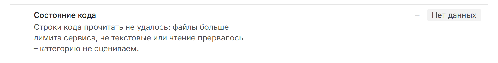

# Обработка отсутствующих данных

HealthCraft отличает «плохо» от «неизвестно». Если факт получить не удалось, подметрика или категория получает «нет данных» и в оценке не участвует: ее не считают ни нулем, ни плюсом. Причину всегда называют карточка и отчет.

## 3 состояния факта {#sostoyaniya}

| Состояние | Что значит | Пример |
|---|---|---|
| данные есть | источник ответил, факт получен | в корне есть файл LICENSE |
| данных нет | источник ответил, но факта нет | у токена нет права на AppSec, проверка AppSec еще не закончилась |
| источник не ответил | сбой доставки | ошибка сети, ответ 429 или 5xx от SourceCraft |

Если не ответил AppSec, HealthCraft записывает «данных нет» с причиной «AppSec ответил не полностью».

## Данные из прошлого анализа {#proshlyy-analiz}

Если источник не ответил, HealthCraft берет тот же факт из прошлого анализа этого репозитория, а если такого анализа нет, у подметрики «нет данных».

Для результатов запусков CI и находок AppSec правило шире: значение из прошлого анализа подставляется при любом состоянии, кроме «данные есть». Анализ по расписанию идет без вашего токена и этих закрытых данных не видит, так что без подстановки он стирал бы то, что собрал анализ с токеном. По той же причине отзыв доступа к CI или AppSec не убирает категорию.

Если новый анализ открытого репозитория не получил открытые данные из-за прав или сбоя, в рейтинге и на карточке остается последний анализ, в котором эти данные получены.

У 4 открытых категорий подстановку видно в 3 местах. На карточке у категории стоит отметка [[label-warning:Данные из прошлого анализа]], в рейтинге – отметка [[label-warning:Из истории]], а внизу карточки ее описывает раздел [[Ограничения данных]]. CI/CD и Безопасность показываются по последним полученным данным CI и AppSec, отдельной отметки у этих категорий нет.

Справочные показатели, например ревью предложений изменений и карта владельцев файлов, из прошлого анализа не подставляются. Если источник не ответил, у них «нет данных» с причиной.

## Подтвержденное отсутствие – это данные {#podtverzhdennoe}

Если HealthCraft точно знает, что чего-то нет, это тоже факт, и он оценивается:

- нет файла лицензии, CONTRIBUTING или CODEOWNERS – подметрика 0;
- задач нет совсем – категория [[Задачи]] получает 0;
- нет релизов или предложений изменений – подметрика 0;
- нет `.sourcecraft/ci.yaml` при видимых запусках – CI/CD 0;
- проверка AppSec прошла без находок – плотность находок 100, даже если размер кода неизвестен;
- пометок TODO в коде нет – плотность и доля старых пометок по 100;
- в прочитанной истории нет коммитов людей – свежесть и число авторов 0;
- запуски CI видны, но успешных нет – длительность запуска 0;
- запуски CI есть, но ни один не завершился: все отменены, пропущены или еще идут – CI/CD 30, как у CI без запусков;
- проверка AppSec ни разу не запускалась – Безопасность 0;
- за 12 месяцев нет коммитов людей – релизы не засчитываются;
- предложений изменений нет – на карточке [[предложения изменений не используются]];
- в репозитории нет кода или ни одного коммита – оценка 0, как описано в разделе [Репозиторий без кода](scores.md#bez-koda).

О подтвержденном отсутствии HealthCraft узнает из ответа источника. Например, SourceCraft ответил, что в разделе «Задачи» репозитория 0 задач. Без задач не видно, как команда отвечает пользователям, поэтому Задачи получают 0, а рекомендация «Заведите задачи в репозитории» подсказывает, что делать. Если же API задач не ответил и прошлого анализа с задачами нет, у Задач «нет данных», и оценку они не снижают.

Пороги для всех этих случаев приведены на странице [Категории и метрики](metrics.md).

## Причины «нет данных» у категорий {#prichiny}

Причину карточка пишет прямо в строке категории.

| Категория | Причина |
|---|---|
| Документация, Активность, Состояние кода, CI/CD | клон не удался: ошибка или репозиторий не удалось скачать в пределах лимитов сервиса |
| Документация, Активность, CI/CD | в репозитории нет ни одного коммита, оценка при этом 0 |
| Задачи | список задач не получен |
| Состояние кода | строки кода не прочитаны |
| Состояние кода | строки кода посчитаны прежней версией сборщика: категория оценится после повторного анализа |
| CI/CD | результаты запусков не видны |
| CI/CD | `ci.yaml` не удалось разобрать, а завершенных запусков нет или они не видны |
| CI/CD | завершенных запусков нет, а у части запусков статус, незнакомый сервису: карточка пишет «Запуски CI идут, завершенных пока нет» |
| Безопасность | у токена нет права на AppSec |
| Безопасность | проверка AppSec еще не закончилась |
| Безопасность | AppSec ответил не полностью, поэтому данных о безопасности нет |
| Безопасность | находки есть, но размер кода неизвестен и доля закрытых не посчитана |
| Безопасность, подметрика «Уязвимые зависимости» | в репозитории нет lock-файла поддерживаемого формата, корзины SCA AppSec не ответили или находки взяты из прошлого анализа; остальные подметрики категории считаются |

Клон выходит за лимиты сервиса по размеру или по времени. Если скачивание уперлось только во время, карточка пишет «Репозиторий не удалось скачать за отведенное время (…) – повторим при следующем анализе». При анализе по вашему токену превышение времени считается сбоем, а не свойством репозитория. Подробно причину описывает раздел [[Ограничения данных]], а если оценки нет, она же одной строкой стоит под [[label-unknown:Оценки нет]]. Как HealthCraft работает с крупными репозиториями, описано на странице [Периодический анализ и масштабирование](../ops/scaling.md).

Закрытую категорию отметкой «нет данных» не помечают. Если CI/CD или Безопасность вам не видны, строки категории нет, а карточка пишет, кому эти данные видны. Подробнее – в разделе [HealthCraft Index и Repo Health Score](scores.md#dva-pokazatelya).

## Как «нет данных» видно в интерфейсе {#v-interfeyse}

- В строке категории на карточке вместо балла стоит прочерк, отметка [[label-unknown:Нет данных]] и причина. Над списком категорий один раз написано «Категории без данных в оценке не участвуют и ее не снижают», в отчете эта фраза стоит под таблицей категорий.
- В колонке категории в рейтинге стоит отметка [[label-unknown:н/д]].
- У подметрики без данных в раскрытой категории вместо баллов стоит прочерк, а значение называет причину.
- Если полнота данных ниже 0,4, на карточке вместо числа стоит отметка [[label-unknown:Оценки нет]], а в рейтинге репозиторий попадает на вкладку [[Без оценки]]. Если пригодного анализа еще не было, карточка вместо оценки показывает заголовок «Оценки пока нет» с причиной.
- В окне факта у рекомендации появляется отметка [[label-unknown:Данных нет]] или [[label-warning:Источник не ответил]].

## Как «нет данных» влияет на оценку {#vliyanie}

Вес подметрики или категории без данных делится между остальными, а если полнота данных ниже 0,4, оценки нет. Оба правила с примерами разобраны в разделах [Категория без данных](scores.md#bez-dannyh) и [Порог данных](scores.md#porog-dannyh).

## Полезные ссылки

- [Показатели и формула расчета](scores.md)
- [Категории и метрики](metrics.md)
- [Карточка репозитория и отчеты](../guide/card.md)
- [Источники данных и приватность](../data/sources.md)
- [Периодический анализ и масштабирование](../ops/scaling.md)
