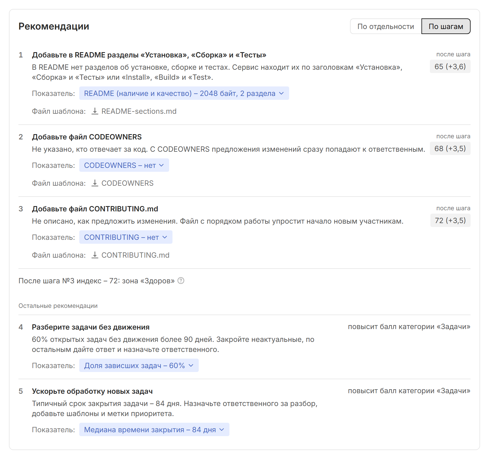

# Формирование рекомендаций

Рекомендация говорит, что сделать с репозиторием, почему и насколько после этого вырастет оценка. Их составляет код по фиксированным правилам: правило проверяет факты последнего анализа и, если условие выполнено, предлагает действие. Языковая модель не выбирает рекомендации и не меняет их порядок. На карточке репозитория они собраны в разделе [[Рекомендации]].

## Из чего состоит рекомендация

Номер рекомендации задает приоритет: рекомендацию №1 выполняйте первой, а как строится порядок, описано в разделе [Порядок](#poryadok). За номером идет действие с глаголом, например «Добавьте файл CODEOWNERS», и строка-причина: что не так и чем это мешает проекту, например «В репозитории нет лицензии: без нее другие не могут законно использовать код».

После подписи [[Показатель:]] стоит плашка с подметрикой и ее значением, например [[label-info:CODEOWNERS – нет]]. Плашка открывает факт, на котором держится рекомендация, – подробнее об этом в разделе [Переход к фактам](../quickstart.md#facts). Последним указан ожидаемый эффект: прирост оценки, например [[label-unknown:+3,5 к HealthCraft Index]], или его описание словами.

## Правила {#pravila}

Правила из таблицы ниже меняют HealthCraft Index, и их рекомендации видят все.

| Действие | Когда срабатывает | Эффект |
|---|---|---|
| Добавьте файл лицензии | в корне нет лицензии: `LICENSE`, `COPYING`, `UNLICENSE` или каталога `LICENSES/` | число |
| Добавьте файл README.md | в корне нет README | число |
| Добавьте в README разделы | README есть, но в нем нет раздела «Установка», «Сборка» или «Тесты» | число |
| Добавьте файл CONTRIBUTING.md | в корне нет CONTRIBUTING | число |
| Добавьте файл CODEOWNERS | в корне нет CODEOWNERS | число |
| Добавьте тесты | категория «Состояние кода» оценена, непустых файлов тестов нет | число для тестов в 10% файлов кода |
| Ведите задачи в трекере | в трекере 0 открытых и 0 закрытых задач | словами |
| Разберите задачи без движения | 50% открытых задач и больше не менялись дольше 90 дней | словами |
| Ускорьте обработку новых задач | медиана закрытия задачи – от 30 дней | словами |
| Разберите устаревшие пометки TODO и FIXME | от 30% пометок старше 180 дней | словами |
| Добавьте код проекта | в репозитории нет кода | словами |

Если кода нет, HealthCraft показывает единственную рекомендацию – «Добавьте код проекта». Правила про задачи и пометки срабатывают, только если у категории есть балл. Для Активности правил нет: ее поднимает сама работа над проектом, а короткие пути подталкивали бы к искусственным коммитам.

Правила категорий CI/CD и Безопасность меняют Repo Health Score, поэтому их видит только тот, кому открыты эти категории.

| Действие | Когда срабатывает | Эффект |
|---|---|---|
| Устраните утечки секретов | AppSec нашел открытый критичный секрет | снимет ограничение 49 с Repo Health Score |
| Устраните критичные находки AppSec | есть открытые находки критичности `critical` | снимет потолок 40 с категории или повысит ее балл и снимет ограничение 69 с Repo Health Score |
| Устраните находки AppSec высокой важности | есть открытые находки `high`, нет `critical` | снимет потолок 69 с категории или повысит ее балл |
| Подключите проверку AppSec | данных AppSec нет | добавит категорию «Безопасность» |
| Настройте CI | нет файла `.sourcecraft/ci.yaml` | число; если запуски не видны – словами |
| Добавьте команды в ci.yaml | в `ci.yaml` нет задачи с командой | число; если запуски не видны – словами |
| Откройте доступ к результатам CI | `ci.yaml` с командами есть, запуски не видны | откроет категорию CI/CD |
| Запустите CI | `ci.yaml` с командами есть, запусков нет | словами |
| Почините CI | последний завершенный запуск с ошибкой или доля успешных запусков ниже 90% | словами |
| Ускорьте CI | медиана длительности запуска больше 15 мин | словами |

Правила про запуски CI и находки AppSec тоже срабатывают, только если у категории есть балл. Исключение – утечка секрета: о ней рекомендация есть всегда, потому что потолок 49 действует на весь Repo Health Score.

Правила используют те же пороги и расчеты, что и балл. Долю старых пометок правило считает так же, как подметрика, – от числа пометок, но не меньше чем от 5, а долю успешных запусков CI – с поправкой на свежесть, как в категории CI/CD.

## Ожидаемый эффект {#effekt}

Чтобы получить число, HealthCraft:

1. Копирует факты последнего анализа.
2. Меняет факт так, будто рекомендация выполнена: например, отмечает, что лицензия есть.
3. Считает оценку заново: те же веса, перераспределение веса категорий без данных, [потолки](scores.md#potolok) 49 и 69.
4. Вычитает прежнюю оценку из новой.

Разницу HealthCraft показывает с точностью до десятых, например «+5,8 к HealthCraft Index», а у правил CI/CD и Безопасности это число относится к Repo Health Score. Рекомендацию с нулевым или отрицательным эффектом HealthCraft не показывает. Так бывает, если тесты не поднимут балл «Состояния кода», если Repo Health Score держит потолок 49 или 69 или если оценки нет из-за нехватки данных.

Эффект назван словами в 3 случаях:

- правило открывает категорию, у которой еще нет балла, или подключает данные. Например, при пустом трекере у Задач минимум 6, и эффект рекомендации «Ведите задачи в трекере» – «повысит балл категории „Задачи“ (сейчас 6 из 100)»;
- правило про процесс, а не про файл: насколько вырастет балл, зависит от того, как разобрать задачи или починить CI;
- запуски CI не видны: без них категория CI/CD не оценивается, и число дало бы перераспределение веса, а не сам CI.

Рекомендация «Добавьте файл README.md» обещает прирост только за само появление README, а объем и разделы добавят баллы сверх этого.

Каждый эффект считается отдельно от текущих фактов, поэтому эффекты разных рекомендаций нельзя просто сложить. Совместный эффект показывает режим [По шагам](#po-shagam).

## Порядок {#poryadok}

Рекомендации идут в таком порядке:

1. Утечки секретов и критичные находки AppSec, затем красный CI.
2. Рекомендации с числом – по убыванию эффекта. Равные – в постоянном порядке по коду правила.
3. Рекомендации CI без видимых запусков.
4. Рекомендации, которые подключают данные: «Подключите проверку AppSec», «Откройте доступ к результатам CI» и «Ведите задачи в трекере». Они идут по весу категории: сначала Безопасность, затем CI/CD и Задачи.
5. Остальные: находки `high`, CI не запускался, долгий CI, старые пометки, задачи без движения, долгое закрытие задач.

## Режим «По шагам» {#po-shagam}

Режим показывает, какие рекомендации выполнить и в каком порядке, чтобы HealthCraft Index дошел до зоны «здоров». Переключатель [[По отдельности]] / [[По шагам]] появляется, если округленный индекс ниже 70, в репозитории есть код и хотя бы одна рекомендация поднимает индекс числом.

HealthCraft строит шаги так:

1. Для каждой публичной рекомендации с числом считает эффект на текущих фактах.
2. Выбирает рекомендацию с наибольшим эффектом и применяет ее исправление.
3. Пересчитывает индекс и повторяет шаги 1-2 поверх уже примененных исправлений.
4. Останавливается, когда округленный индекс достигнет 70, рекомендации с положительным эффектом закончатся или шагов станет 12.

Порядок жадный: на каждом шаге выбирается наибольший прирост. Рекомендации CI/CD и Безопасности в шаги не входят, потому что меняют Repo Health Score, а он виден не всем.

Например, у выдуманного `example/tasktracker` HealthCraft Index 61:

| Шаг | Рекомендация | Прирост | Индекс после шага |
|---:|---|---:|---:|
| 1 | Добавьте в README разделы «Установка», «Сборка» и «Тесты» | +3,6 | 65 |
| 2 | Добавьте файл CODEOWNERS | +3,5 | 68 |
| 3 | Добавьте файл CONTRIBUTING.md | +3,5 | 72 |

Под шагами – итог «После шага №3 индекс – 72: зона „Здоров“». Если исправлений не хватает, итог называет разрыв: «После шага №N индекс – X, до 70 не хватит Y». Рекомендации, которые в шаги не вошли, идут ниже, под заголовком [[Остальные рекомендации]].

Шаги – это расчет по текущим данным, а не новая оценка. Они не сохраняются и не попадают в отчет, публичный API и сравнение, а сам индекс изменится только после нового анализа.

## Заготовки файлов {#zagotovki}

Для 5 правил документации HealthCraft готовит заготовку файла, ее скачивают кнопкой после подписи [[Файл шаблона:]]. Заготовку собирает код по шаблону и фактам анализа, без языковой модели. Имена файлов и заголовки разделов в ней те же, что ищет HealthCraft, поэтому следующий анализ засчитает файл.

| Рекомендация | Файл | Что внутри |
|---|---|---|
| нет README | `README.md` | заголовок, разделы «Установка», «Сборка», «Тесты», «Как участвовать» |
| в README не хватает разделов | `README-sections.md` | только недостающие разделы – перенесите их в свой README |
| нет CONTRIBUTING | `CONTRIBUTING.md` | как сообщить об ошибке, предложить изменение, запустить тесты, стиль кода |
| нет CODEOWNERS | `CODEOWNERS` | владелец по умолчанию и строки для каталогов из карты владельцев |
| нет лицензии | `LICENSE` | текст MIT или Apache 2.0 на выбор; в MIT подставлены текущий год и имя организации из адреса репозитория |

Адреса электронной почты в заготовки не попадают: в `CODEOWNERS` имена авторов из git стоят подсказкой в комментариях.

Чтобы добавить файл по заготовке:

1. Нажмите кнопку с именем файла, например [[download:CODEOWNERS]]. Для лицензии выберите пункт [[MIT]] или [[Apache 2.0]].
2. Положите файл в корень репозитория.
3. Замените заполнители в угловых скобках, например `<команда сборки>`, а в `CODEOWNERS` – каждый `@login` логином ответственного в SourceCraft.
4. На карточке своего репозитория нажмите [[Обновить анализ]] или дождитесь анализа по расписанию.

## Полезные ссылки

- [Карточка репозитория и отчеты](../guide/card.md)
- [Показатели и формула расчета](scores.md)
- [Категории и метрики](metrics.md)
- [Устойчивость оценки и защита от накрутки](robustness.md#scenarii)
- [Обработка отсутствующих данных](no-data.md)
