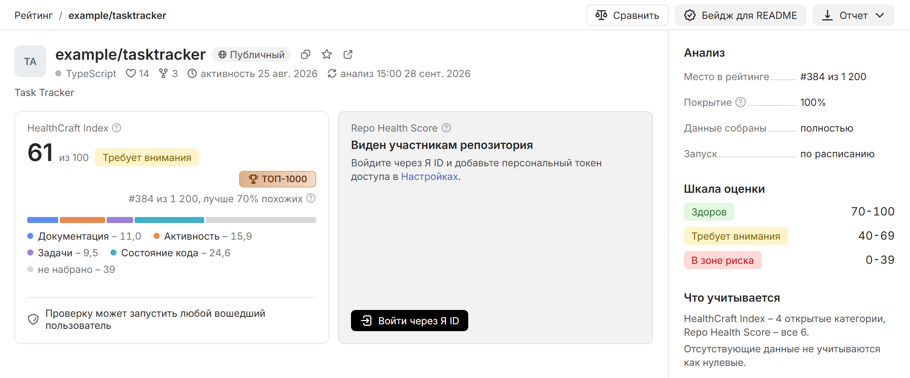

# Начало работы

За 10-15 минут вы найдете репозиторий в рейтинге, разберете его оценку и запустите анализ своего репозитория. Первые 4 раздела работают без входа. Для остальных нужны аккаунт Яндекс ID и свой репозиторий в SourceCraft.

В примерах – выдуманный репозиторий `example/tasktracker` с HealthCraft Index 61.

## Рейтинг, фильтр и сортировка {#rating}

Чтобы отобрать репозитории:

1. Откройте [health-craft.ru](https://health-craft.ru). Откроется раздел [[rating:Рейтинг]], отсортированный по HealthCraft Index: сверху – самые высокие оценки. На мобильных устройствах список разделов открывается кнопкой меню слева в верхней строке.
2. В фильтре [[Язык:]] выберите язык, например Python. Рядом – фильтры [[Размер:]] и [[CI:]].
3. Чтобы отсортировать иначе, нажмите заголовок колонки, например [[Реакции]].
4. Нажмите ссылку [[Как считается?]] под заголовком. Панель покажет шкалу оценок, порог полноты данных и раздел [[Вклад категорий]] с долей каждой категории в процентах. Вес категории появляется в подсказке, если навести указатель на ее строку.

Колонка [[#]] показывает место в общем рейтинге, а стрелка рядом с ним – изменение за сутки. Остальные колонки и фильтры описаны на странице [Рейтинг и сравнение репозиториев](guide/rating.md).

## Карточка репозитория {#card}

Чтобы открыть карточку:

1. В поле [[search:Поиск]] введите имя репозитория.
2. Нажмите на строку репозитория. Карточка также открывается по адресу `https://health-craft.ru/repo/<org>/<repo>`.

На карточке вы увидите, например, HealthCraft Index 61 с плашкой [[label-warning:Требует внимания]], лигу [[league-bronze:TOP-1000]], строку места «#152 из 28 500, лучше 94% похожих» и раздел [[Категории]] с баллом каждой категории. Repo Health Score виден только участникам репозитория.

## Переход к фактам {#facts}

Чтобы увидеть факты, на которых держится оценка:

1. В разделе [[Категории]] нажмите строку категории, например [[Задачи]]. Откроются подметрики: значение и сколько баллов категории набрала каждая из своего веса.
2. В разделе [[Рекомендации]] у любой рекомендации нажмите [[Источник данных]]. Откроются источник факта и время его сбора.
3. В открывшемся окне нажмите [[Исходные данные]]. Откроется значение факта в том виде, в каком его сохранил анализ.

Категория без данных помечена [[label-unknown:Нет данных]] и оценку не снижает. Почему так, объясняет страница [Обработка отсутствующих данных](method/no-data.md).

## Рекомендации и отчет {#recommendations}

Чтобы проверить рекомендации и скачать отчет:

1. Прокрутите карточку до раздела [[Рекомендации]]. У каждой рекомендации указаны действие, причина и прирост индекса справа, например «+3,5».
2. Если индекс ниже 70, раздел начинается с итога, например «3 шага выведут индекс в зону «Здоров»», а шаги идут лесенкой с индексом после каждого.
3. У рекомендации с заготовкой файла нажмите кнопку с именем файла, например [[CODEOWNERS]]. В окне будут текст заготовки и кнопки [[Скопировать]] и [[download:Скачать]].
4. В строке действий карточки нажмите [[download:Отчет]] и выберите [[markdown:Markdown (.md)]] или [[pdf:PDF (.pdf)]].

Как строятся рекомендации – на странице [Формирование рекомендаций](method/recommendations.md).

## Вход и персональный токен {#login}

Яндекс ID подтверждает, кто вы, а персональный токен SourceCraft дает HealthCraft читать данные SourceCraft от вашего имени. HealthCraft только читает и видит ровно те данные, к которым у токена есть доступ.

Чтобы войти и сохранить токен:

1. Внизу левой панели нажмите [[login:Войти]].
2. Войдите через Яндекс ID.
3. Внизу левой панели откройте [[settings:Настройки]].
4. В SourceCraft нажмите [[Домой]] и откройте [[Доступ]] → [[Персональные токены доступа]].
5. Нажмите [[plus:Новый токен]].
6. В поле [[Доступ к репозиторию]] выберите [[Все права учетной записи]]. Подойдет и [[Все репозитории]].
7. Скопируйте токен: SourceCraft показывает его 1 раз.
8. В HealthCraft вставьте токен в поле [[Персональный токен доступа SourceCraft]] и нажмите [[Проверить и сохранить]].

HealthCraft проверяет токен запросом к SourceCraft и сохраняет только принятый. После сохранения появится отметка [[label-success:Сохранен]]. Если при проверке SourceCraft сообщил имя владельца токена, ниже появится строка «Токен принадлежит пользователю …». Репозитории, доступные токену, появятся в разделе [[repos:Мои репозитории]]. В [[favorites:Избранное]] сами они не попадают – туда вы добавляете репозитории сами. В том же разделе есть кнопки [[Заменить]] и [[Удалить]]. Кнопка [[logout:Выйти]] токен не удаляет: он привязан к аккаунту, а не к сессии. Как HealthCraft хранит токен – на странице [Источники данных и приватность](data/sources.md).

## Свой репозиторий и доступ {#dostup}

**Свой репозиторий** – репозиторий, где токену доступны CI/CD или Безопасность, либо приватный или внутренний репозиторий, который токен видит.

Анализ по кнопке можно запустить для своего репозитория и для любого репозитория ваших организаций – всех, что есть в [[repos:Мои репозитории]]. Остальные открытые репозитории HealthCraft анализирует сам по расписанию. Если токену не видны CI/CD и Безопасность открытого репозитория, анализ оценит 4 открытые категории, как анализ по расписанию, и запускается не чаще раза в 6 часов после последнего удачного анализа – это общее правило для всех участников организации.

Кроме того, токен открывает карточки закрытых репозиториев, которые он видит, и категории CI/CD и Безопасность, если токену доступны эти данные. Repo Health Score появляется, когда доступны обе категории. Закрытые репозитории не входят в рейтинг и недоступны через публичный API.

## Анализ своего репозитория {#own}

Для анализа нужен ваш репозиторий в SourceCraft. Если его нет, создайте новый или добавьте существующий.

Чтобы запустить анализ:

1. Откройте [[repos:Мои репозитории]]. Там все репозитории, доступные вашему токену, по организациям: ваше пространство – первым, внутри организации закрытые – первыми.
2. Найдите репозиторий поиском или сузьте список: [[Все]], [[Закрытые]] или [[Публичные]], а также [[Организация:]], [[Состояние:]] и [[Язык:]] – в каждом можно выбрать несколько значений. На телефоне фильтры – за кнопкой [[Фильтры]]. Выбор сохраняется в адресе страницы, поэтому после карточки список тот же.
3. Нажмите в строке [[play:Запустить анализ]]. У репозитория, который уже анализировали, это пункт [[refresh:Обновить анализ]] в меню [[more:Действия с репозиторием]]. Открытые репозитории HealthCraft оценивает и сам по расписанию. Если открытый репозиторий анализировали недавно, уведомление скажет, когда запуск снова доступен. Репозиторий без анализа тоже открывается: карточка предложит запустить анализ. У пустого репозитория, где нет ни одного коммита, запуска нет – анализировать нечего.
4. Чтобы следить за репозиторием, выберите в меню [[more:Действия с репозиторием]] пункт [[star:Добавить в избранное]]. Репозиторий, которого нет в списке, добавьте в [[favorites:Избранное]] кнопкой [[plus:Добавить]] по ссылке на него. Если репозиторий закрытый или токену видны его CI/CD или Безопасность, первый анализ запустится сам.

[[favorites:Избранное]] – список наблюдения: рядом с оценкой стрелка показывает изменение к прошлой оценке, а сортировка [[По изменению]] поднимает наверх репозитории, где оценка сдвинулась сильнее всего.

Состояние в строке сменится на [[busy:В очереди]], затем на [[busy:Идет анализ]]. Идущие анализы показывает кнопка [[jobs:Очередь]] вверху страницы, а итоги последних запусков и причины ошибок – ее вкладка [[История]]. Когда анализ закончится, придет уведомление [[Анализ завершен]], и в строке появятся оценка и время анализа. Если данных для оценки не хватило, в строке будет [[state+dashed:Оценки нет]]. Если анализ не удался, а пригодной оценки у репозитория еще нет, в строке будет [[state-danger+exclamation:Ошибка анализа]]. Если оценка уже была, строка продолжит показывать ее.

## Повторный анализ {#rescan}

Чтобы проанализировать свой репозиторий или репозиторий вашей организации еще раз:

1. В [[repos:Мои репозитории]] или [[favorites:Избранное]] нажмите на имя репозитория. Откроется его карточка.
2. В строке действий нажмите [[Обновить анализ]]. В строке списка это пункт [[Обновить анализ]] в меню [[more:Действия с репозиторием]].
3. Дождитесь уведомления [[Анализ завершен]].

Новый анализ появится на карточке в разделе [[История оценки]]. Число запусков в час ограничено, лимиты перечислены на странице [Ограничения](limits.md).

## Пересчет по расписанию {#schedule}

Оценки открытых репозиториев HealthCraft обновляет сам, без вашего участия. Как устроено расписание, описано на странице [Периодический анализ и масштабирование](ops/scaling.md).

## Полезные ссылки

- [Рейтинг и сравнение репозиториев](guide/rating.md)
- [Карточка репозитория и отчеты](guide/card.md)
- [Показатели и формула расчета](method/scores.md)
- [Источники данных и приватность](data/sources.md)
- [Внешние сервисы и AI](data/ai.md)
